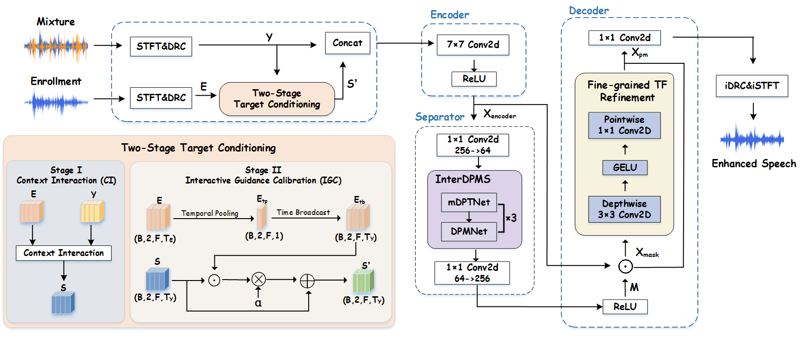
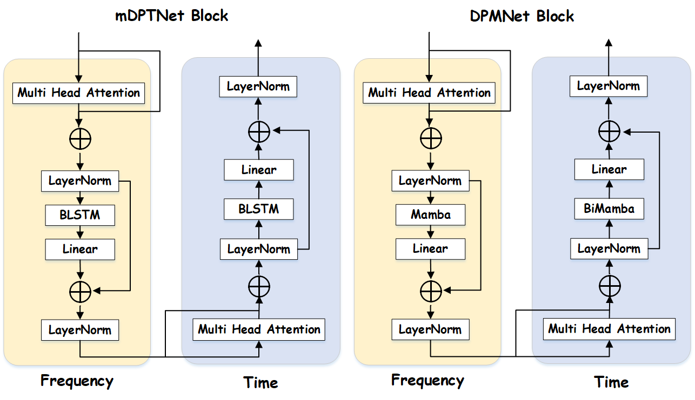

#  IGC-DPMNet





**IGC-DPMNet** is a lightweight target speaker extraction (TSE) network designed to extract the speech of a designated target speaker from noisy or multi-speaker mixtures with a favorable trade-off between extraction performance and computational complexity. It adopts a two-stage target conditioning framework with an **Interactive Guidance Calibration (IGC)** module, which dynamically calibrates frame-level interactive guidance using global enrollment representations. The extraction backbone employs an **Interleaved Dual-Path Modeling Separator (InterDPMS)**, which alternately integrates BLSTM-based and Mamba-based dual-path blocks to capture complementary long-range dependencies while reducing computational costs. A **Fine-Grained TF Refinement (FG-TFR)** block is further embedded into a lightweight decoder to refine local time-frequency representations and suppress feature artifacts. Experiments on Libri2Mix, WSJ0-2Mix, WHAM!, and WHAMR! demonstrate its effectiveness and generalization, achieving competitive extraction performance with only **1.99M** parameters and **13.45G MACs**.


- Checkpoint: [github.com/Yym-line/IGC-DPMNet/ckpt](https://github.com/Yym-line/IGC-DPMNet/tree/main/ckpt)
- Demo: [IGC-DPMNet demo](https://yym-line.github.io/IGC-DPMNet/)

## Train

```bash
./train.sh
```

The complete code for model training will be released once the paper is accepted.


## Inference

Python 3.10:

```bash
git clone github.com/Yym-line/IGC-DPMNet.git
cd IGC-DPMNet
pip install -r requirements.txt
```

To evaluate the model, use the provid ed `eval.sh` script. It sets the necessary parameters (e.g., model checkpoint, GPU ID, data paths) and calls `evaluate_avg_estoi_8k.py` for performance evaluation:

`eval.sh`: Runs the evaluation by setting paths and calling `evaluate_avg_estoi_8k.py`.

```bash
./eval.sh
```

`evaluate_avg_estoi_8k.py`: Evaluates the model on the test set (Libri2Mix, WSJ0-2mix, WHAM!, WHAMR!) under 8kHz sample rate, computing metrics like SDR, SI-SNR, PESQ, STOI and eSTOI.


To inference the model, use the provided `separate.sh` script. It sets the necessary parameters (e.g., model checkpoint, GPU ID, data paths, sample rate) and calls `separate_aver.py` for inferencing.

```bash
./separate.sh
```

`separate_aver.py`: Inference the model on the test set (Libri2Mix, WSJ0-2mix, WHAM!, WHAMR!) under 8kHz / 16kHz sample rate. One or more models can be selected for inference.


## Data

We have provided the data paths for the test set (**Libri2Mix, WSJ0-2mix, WHAM!, WHAMR!**) under the `test` directory. Among these, Libri2Mix includes both 8k and 16k sampling rates, while the others are all 8k.

In the Libri2Mix folder, `mix_both` refers to the scenario involving `2-speaker+noise`, while `mix_clean` refers to the scenario with `2-speaker`.

You will need to download the original audio files yourself.


## Results

#### Libri2Mix (8k mix_clean)

| Method | SI-SDR | PESQ | eSTOI | Params | GMACs |
|---|---:|---:|---:|---:|---|
| Mixture | -0.03 | 1.60 | 53.8 | - | - |
| TD-SpeakerBeam | 12.86 | 2.75 | - | - | - |
| SpEx+ | 13.41 | 2.93 | 82.4 | 11.78M | 10.73 |
| sDPCCN | 11.62 | 2.76 | 78.9 | 6.63M | **8.49** |
| BSRNN | 15.2 | - | - | 25.97M | 98.69 |
| MC-SpEx | 14.61 | 3.19 | 84.9 | 10.77M | - |
| X-TF-GridNet | 16.2 | **3.53** | 86.94 | 7.79M | 68.32 |
| CIE-mDPTNet | 16.05 | 3.48 | 85.51 | 2.9M | 25.18 |
| SEF-PNet | 13.00 | 3.05 | - | 6.07M | 8.50     |
| **IGC-DPMNet** | **16.35** | 3.49 | **87.78** | **1.99M** | 13.45 |


#### Libri2Mix (16k mix_both)

| Method         |    SI-SDR |     PESQ |    eSTOI | STOI (%) | WER      | OVRL     | P808_MOS | SIM       | Params (M) | GMACs     |
| -------------- | --------: | -------: | -------: | -------- | -------- | -------- | -------- | --------- | ---------: | --------- |
| Mixture        |     -1.96 |     1.08 |     0.40 | 64.73    | 0.62     | 1.634    | 2.706    | 0.723     |          - | -         |
| TD-SpeakerBeam |      9.21 |     1.66 |     0.70 | -        | 0.21     | -        | 3.14     | -         |          - | -         |
| DPCCN          |      9.30 |     1.74 |     0.73 | -        | -        | -        | -        | -         |          - | -         |
| X-TF-GridNet   |      9.85 |     1.72 |     0.72 | -        | 0.19     | -        | 3.42     | -         |       7.79 | 48.3      |
| CIE-mDPTNet    |      9.47 |     1.78 |     0.72 | 85.35    | 0.18     | 2.959    | 3.508    | 0.843     |        2.9 | 98.69     |
| SEF-PNet       |      8.18 |     1.55 |     0.68 | 82.67    | 0.22     | 2.983    | 3.592    | 0.821     |       6.08 | **15.87** |
| USEF-TSE       |     10.17 |     1.82 |     0.72 | -        | 0.17     | -        | 3.48     | -         |       15.2 | -         |
| DDTSE          |      7.60 |     1.60 |     0.71 | -        | -        | -        | 3.74     | -         |          - | -         |
| SoloSpeech     | **11.12** | **1.89** | **0.78** | -        | **0.15** | -        | **3.76** | -         |      590.9 | -         |
| **IGC-DPMNet** |     10.34 |     1.87 |     0.74 | 86.78    | **0.15** | **3.02** | 3.611    | **0.851** |  **1.99M** | 26.79     |


#### WSJ0-2mix, WHAM!, WHAMR! (8k)

| Test set | SI-SDRi | SDRi | PESQ |
|---|---|---|---|
| WSJ0-2mix | 20.0    | 20.6 | 3.80 |
| WHAM! | 15.6    | 15.8 | 2.80 |
| WHAMR! | 15.4    | 14.0 | 2.54 |


## Citation

If you find this repository useful or use the code in your research, please cite our paper:

```bibtex
@article{yang2026igcdpmnet,
	title = {IGC-DPMNet: Interactive Guidance Calibration and Interleaved Dual-Path Modeling for Efficient 		Target Speaker Extraction},
	author = {Yang, Yiming and Guan, Haixin and Wei, Shuang and Long, Yanhua},
	journal = {IEEE/ACM Transactions on Audio, Speech, and Language Processing (TASLP)},
	year = {2026},
	note = {Submitted}
}
```


## License

[Apache-2.0](LICENSE)
